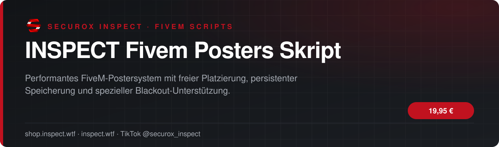
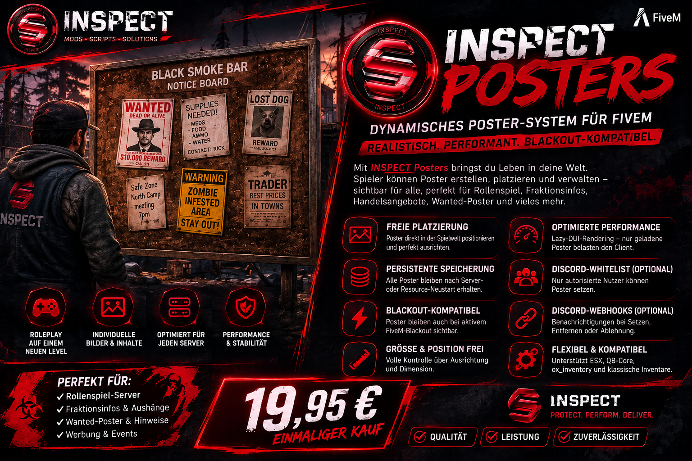

<!-- inspect-showcase: automatisch erzeugt, Änderungen bitte im Shop vornehmen -->

  
  
  
  

<h3>Performantes FiveM-Postersystem mit freier Platzierung, persistenter Speicherung und spezieller Blackout-Unterstützung.</h3>

  
  
  
  

---

## Überblick

INSPECT Posters ist ein modernes In-World-Postersystem für FiveM. Spieler und Administratoren können individuelle Bilder, Hinweise, Werbung, Fraktionsinformationen oder Roleplay-Inhalte direkt in der Spielwelt platzieren. Das System arbeitet mit optimiertem Lazy-DUI-Rendering, persistenter JSON-Speicherung und ist speziell für Server mit aktivem oder dynamischem Blackout geeignet.

## Funktionen

- ✅ Freie Poster-Platzierung in der Spielwelt
- ✅ Eigene Bild-URLs und individuelle Motive
- ✅ Größe und Position frei anpassbar
- ✅ Persistente Speicherung per JSON
- ✅ Lazy-DUI-Rendering für geringe Clientlast
- ✅ Konfigurierbare Render- und Streaming-Distanzen
- ✅ Blackout-kompatible Darstellung
- ✅ Optionales Poster-Licht
- ✅ Discord-Whitelist optional
- ✅ Discord-Webhooks optional
- ✅ Admin-Entfernen-Modus
- ✅ ESX-/QB-Core-Unterstützung
- ✅ ox_inventory-Unterstützung
- ✅ ox_lib-Unterstützung
- ✅ INSPECT Events und Exports
- ✅ Legacy-Kompatibilität für bestehende posters:* Integrationen

## Einblicke

<table>
  <tr>
    <td width="50%"></td>
  </tr>
</table>

## Video

Neue Clips, Updates und Vorschauen gibt es regelmäßig auf TikTok: **[@securox_inspect](https://www.tiktok.com/@securox_inspect)**

## Preise

| Produkt | Preis |
|:--|--:|
| INSPECT Fivem Posters Skript | **19,95 €** |

<a href="https://shop.inspect.wtf/produkt/inspect-posters"><b>➜ Zum Produkt im Shop</b></a>

## Kauf, Einrichtung & Support

1. **Kaufen** im offiziellen Shop: [shop.inspect.wtf](https://shop.inspect.wtf) – PayPal und Karte, Rechnung automatisch per E-Mail.
2. **Freischaltung & Download** findest du sofort nach der Zahlung in deinem Kundenkonto.
3. **Hilfe** bekommst du im [INSPECT Discord](https://discord.gg/inspect) – schnell, persönlich und auf Deutsch.

| | |
|:--|:--|
| 🛒 Shop | [shop.inspect.wtf](https://shop.inspect.wtf) |
| 🌐 Website | [inspect.wtf](https://inspect.wtf) |
| 💬 Discord | [discord.gg/inspect](https://discord.gg/inspect) |
| 🎬 TikTok | [@securox_inspect](https://www.tiktok.com/@securox_inspect) |
| ✉️ E-Mail | [info@inspect.wtf](mailto:info@inspect.wtf) |

---

<b>INSPECT</b> · Offizielle Produktpräsentation. Dieses Repository enthält keinen Quellcode und keine Produktdateien. 
Kauf und Lizenzen ausschließlich über <a href="https://shop.inspect.wtf">shop.inspect.wtf</a> · Inhalte werden automatisch aus dem Shop aktualisiert.

